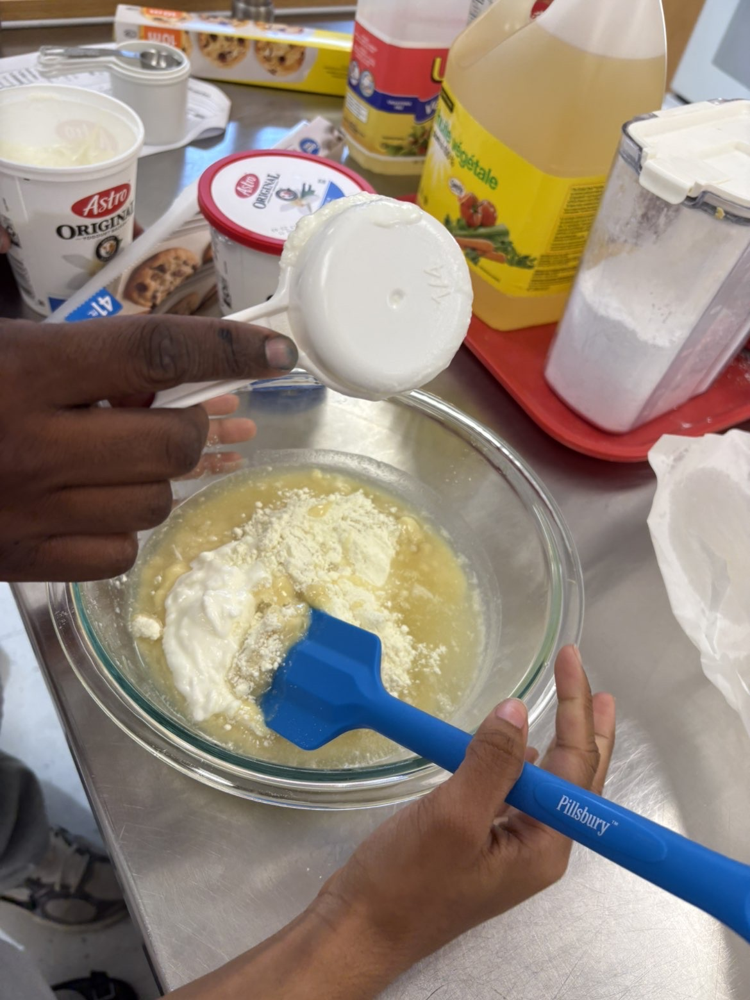
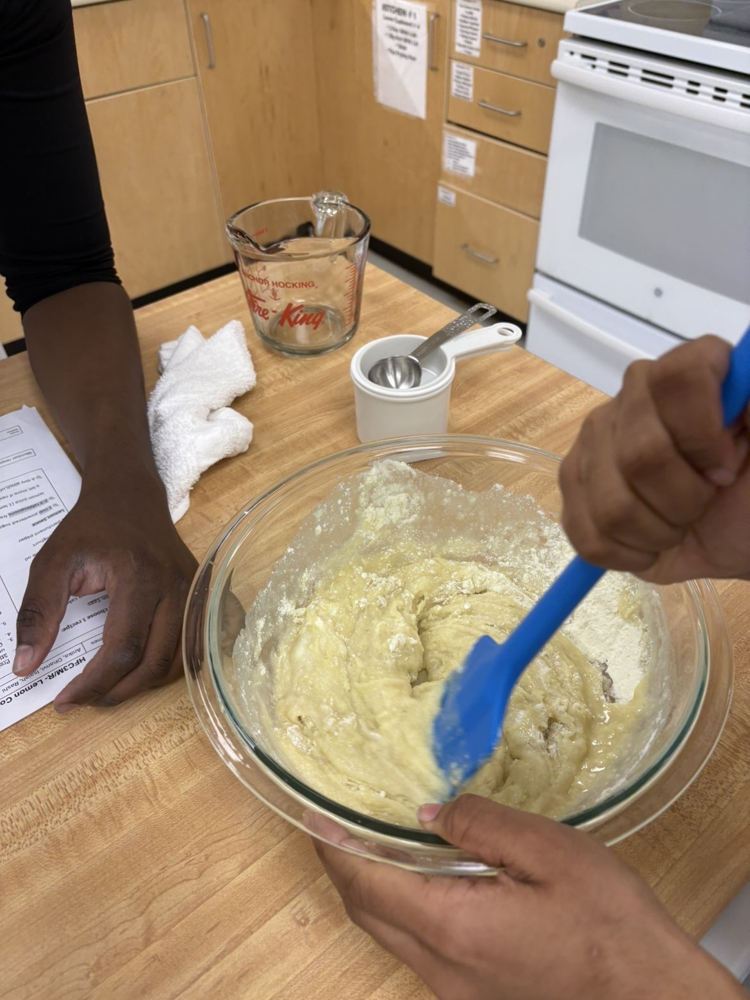
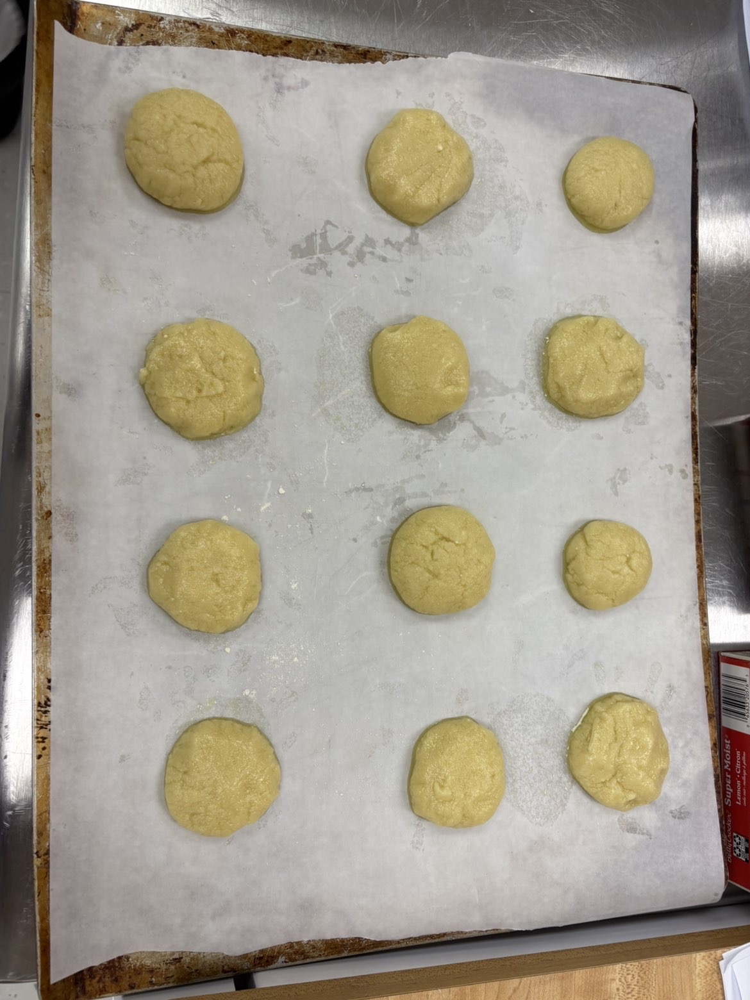
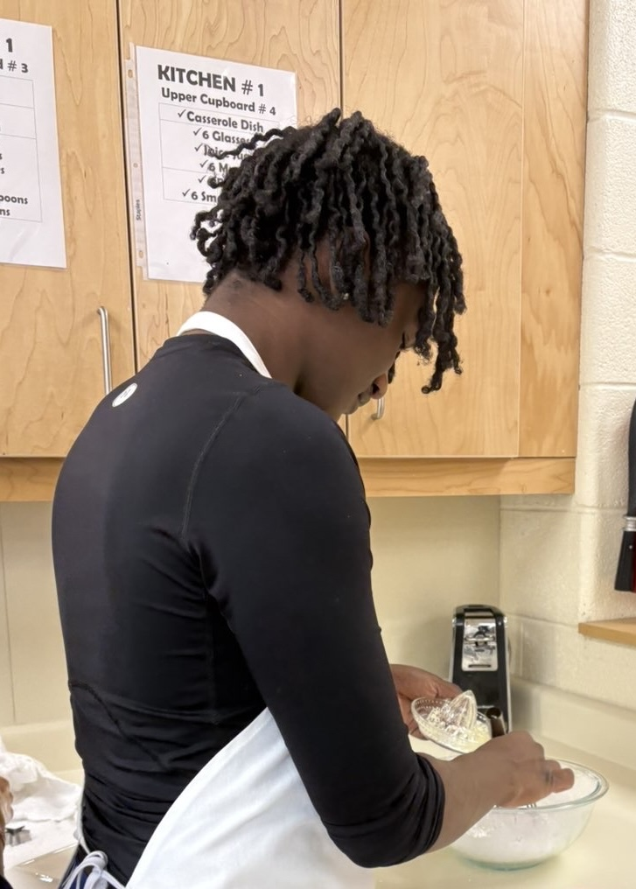
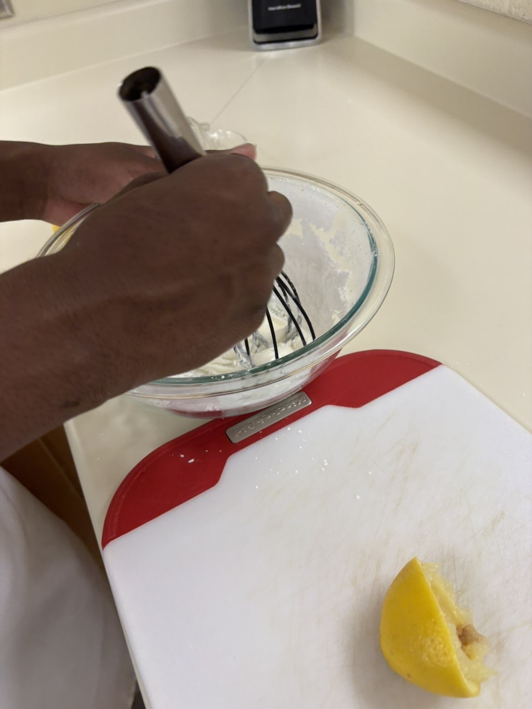
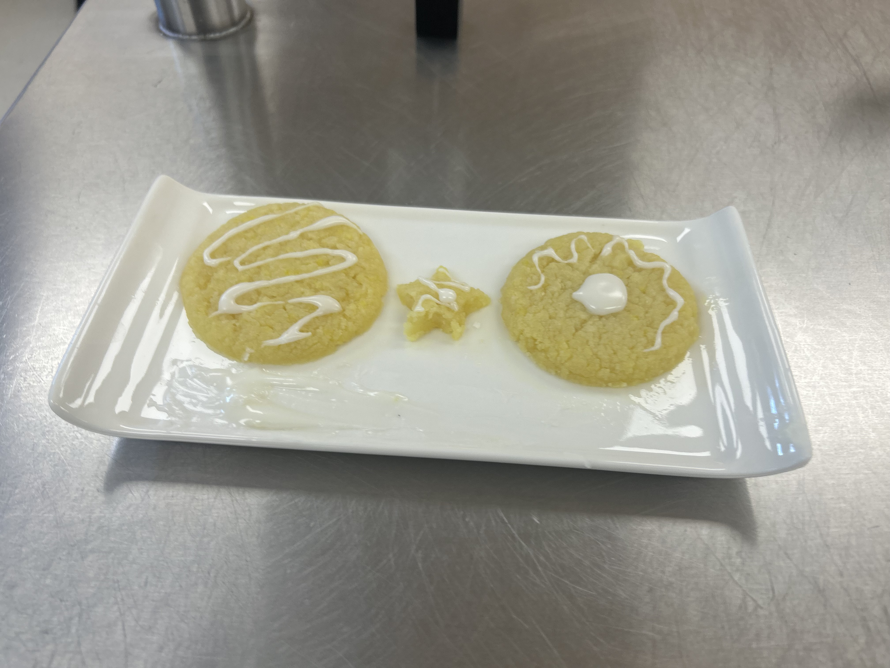

# Food & Cultures: My Cookbook Journey
### Entry #3: 3-Ingredient Lemon Cake Cookies with Tangy Lemon Sauce
**Author**: Created & Crafted by **Isaiah Gardner**  
**Group Members**: Isaiah, Rashi, Dhanvi, Anika  
**Course**: Food & Cultures Class Lab  
**Date**: October 23rd, 2026  

---

## 📸 Visual Spotlight: Culinary Lab Slideshow (LC1–LC6)

### 1. Photo LC1: Measuring Yoghurt & Cake Mix

### 2. Photo LC2: Stirring & Folding the Cookie Dough

### 3. Photo LC3: Rolling Dough Balls onto Parchment Sheet

### 4. Photo LC4: Squeezing Fresh Lemon Juice

### 5. Photo LC5: Whisking the Tangy Lemon Glaze

### 6. Photo LC6: Final Plated Lemon Cookies Presentation

**Ingredients (Hover & Click To Pop!)**:  
🍋 Fresh Lemon Juice | 🍚 Lemon Cake Mix | 🥛 Yoghurt Swap | 🫒 Vegetable Oil | 🍬 Powdered Sugar | 🧂 Pinch of Salt | 📄 Parchment Paper

---

## ⭐ Two Things I Liked
1. **Great Smell, Flavor, and Texture**: The mix of basic cake mix and fresh lemon created a really nice smell while baking that stayed with the cookies. On top of the good scent, the softness and feel of the cookies were just right, making them very fun and nice to eat.
2. **Easy Recipe with Few Ingredients**: Using only three simple ingredients made the baking process super quick, easy, and stress-free. Skipping hard steps, big cleanup, and a long list of things to buy made making these cookies a great experience.

---

## ⚠️ Two Things I Disliked
1. **Too Much Oil on the Outside**: The baked cookies held onto way too much grease, leaving a lot of oil on hands when picked up. This problem was most likely caused by the egg swap, as fake eggs can change how the dough holds oil and water while baking.
2. **Frosting Was Much Too Sour**: The frosting had way too much lemon in it, creating a strong sour taste that hid the sweet flavor underneath. Even after adding extra powdered sugar to fix the strong taste, the sourness was still too high to taste good.

---

## 📝 Lab Summary & Reflection
This recipe is great because it is very easy to make and starts with a good idea, mixing a super simple three-ingredient step with a nice cookie texture and a sweet cake-and-lemon smell. However, the final cookies had a few clear problems with how they were made and how they tasted. The cookies were much too greasy to hold, which was probably caused by the egg swap, and the frosting was so sour that it hid all the sweet flavor, even after trying to fix it with extra sugar.

To make this recipe better next time, changing the egg swap to something that holds oil better and using less lemon in the frosting will make a much better, more delicious treat.

---

## 📋 Recipe & Instructions (Members: Isaiah and Rashi)

### Cookie Dough Options:
- **Without Eggs (Our Lab Choice)**:
  - 1 box Lemon cake mix
  - ⅓ cup vegetable oil
  - ¼ cup yoghurt (egg substitute swap)
  - Parchment paper
- **With Eggs**:
  - 1 box Lemon cake mix
  - 2 large eggs
  - ½ cup vegetable oil
  - Parchment paper

### Tangy Lemon Sauce:
- 1 cup powdered sugar (sifted)
- 2–3 tablespoons fresh lemon juice (1 fresh lemon; plus a bit more if needed)
- Tiny pinch of salt

### Step-by-Step Instructions:
1. Preheat the oven to 350°F (175°C).
2. Stir cake mix, oil, and yoghurt (or eggs) together in a large mixing bowl with a rubber spatula until it forms a uniform dough.
3. Cut parchment paper to the precise size of the baking sheet.
4. Roll dough into 1-inch balls; place 2 inches apart on parchment-lined baking sheet.
5. Bake in preheated oven for about 10 minutes depending on desired softness.
6. Cool cookies on baking sheet for 5 minutes.
7. Transfer to wire rack to cool completely (optional: use fridge towels for rapid cooling).
8. In a medium bowl, combine sifted powdered sugar and 2 tbsp fresh lemon juice.
9. Whisk until smooth and honey-like; adjust with lemon juice or extra sugar.
10. Plate and drizzle creatively with plating spoon for Ms. Levis.

---

## 🛠️ 10 Collected Tools (Members: Isaiah and Dhanvi)
1. **Dry Measuring cups**: Used to measure dry ingredients such as cake mix and powdered sugar.
2. **Dry/Wet Measuring Spoons**: To measure small liquid or dry amounts such as vegetable oil and lemon juice.
3. **Parchment Paper**: To prevent the cookies from sticking onto the pan and burning.
4. **Large/Medium Mixing Bowls**: Large bowl to mix dough ingredients; medium bowl for whisking sauce.
5. **Wire Rack**: To place and cool cookies completely before decorating.
6. **Baking Sheets**: To hold dough balls on parchment paper while baking in the oven.
7. **Whisk**: Used to whisk the powdered sugar and lemon juice together into a smooth glaze.
8. **Rubber Spatula**: To fold cake mix, oil, and yoghurt together into a cohesive dough.
9. **Sifter**: To sift lumps and bumps out of the powdered sugar.
10. **Plating Spoon**: Used to decorate the plate with artistic lemon sauce designs.

---

## 📖 10 Cooking Terms (Member: Rashi)
1. **Stir**: Stir the cake mix, oil, and yoghurt together in a large bowl until dough is formed.
2. **Cut**: Cut parchment paper to size of baking sheet to avoid overhang fire hazards.
3. **Roll**: Roll dough into 1-inch balls; don't make them too large or too small.
4. **Bake**: Bake cookies in preheated oven for about 10 minutes.
5. **Cool**: Cool cookies on baking sheet for 5 minutes before moving to wire rack.
6. **Combine**: Combine powdered sugar and 2 tablespoons of fresh lemon juice.
7. **Sift**: Sift powdered sugar to eliminate clumps and ensure smooth sauce.
8. **Plate**: Plate the final cookie for Mrs. Levis in a creative manner.
9. **Pinch**: Pinch a bit of salt to add balance to the sweet and acidic flavors.
10. **Place**: Place dough rolls 2 inches apart so they do not fuse while baking.

---

## 🛒 Grocery Order List (Member: Dhanvi)
- **Dairy Products**: ¼ cup yoghurt
- **Baking Items**: 1 Lemon cake mix, 1 cup powdered sugar, A tiny pinch of salt
- **Fresh Fruit**: 2–3 tablespoons fresh lemon juice (1 fresh lemon)
- **Other Items**: ½ cup / ⅓ cup vegetable oil, Parchment paper

---

## 🔬 Culinary Science Research & Lemon Facts (Member: Anika)
- **History**: Lemons originated in Asia and spread to Europe through trade. People used lemon juice and zest to flavor biscuits, cakes, and cookies as sugar became widely available.
- **Delicate Ingredient**: Lemon is acidic and can easily overpower other flavors. Too much lemon juice changes baked goods' texture, while too much zest makes food bitter.
- **Lemon vs. Lime**: Lemons are yellow with bright sour flavor; limes are green with sharper, more intense citrus bite.
- **Where Lemons Grow**: Warm, sunny climates like India, Mexico, Spain, Italy, Argentina, California, and Arizona.
- **How Canada Gets Lemons**: Canada imports fresh lemons via refrigerated trucks and ships from warmer regions.
- **5 Lemon-Infused Dishes**: Lemon cookies, Lemon meringue pie, Lemon chicken, Lemon pasta, Lemon cake.
- **3 Fun Facts**: High in vitamin C; Lemon trees can produce fruit year-round; Outer yellow peel contains essential aromatic oils.
